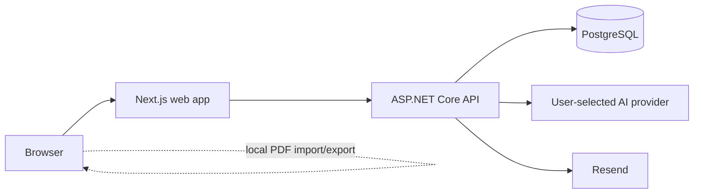

# Resumade

Resumade is a web app for building and revising resumes. Start from a template or import an existing PDF, edit each section alongside a live preview, and download a PDF with selectable text.

**[Open the live frontend](https://resumade-zeta.vercel.app)** · [Explore the screenshots](docs/screenshots.md) · [Run it locally](docs/development.md)


## What you can do

- **Start with a template or an existing PDF.** Choose Classic, Modern, or Custom, or import a PDF with selectable text and review the extracted fields.
- **Use AI on your terms.** Connect OpenAI, Claude, Grok, Gemini, or DeepSeek, opt in to AI-assisted PDF parsing, and tailor a draft to a job description with selective before/after approval.
- **Edit with a live preview.** Reorder sections and entries by dragging, format descriptions with rich text, and adjust the paper size, colours, and margins.
- **Download your current draft.** Guests and signed-in users can export a PDF using the preview’s layout and styling.
- **Save resumes to an account.** Verify your email to sign in with a password, or use Google sign-in. Open and manage your saved resumes from the dashboard.


[See the page gallery](docs/screenshots.md) for the start flow, templates, account pages, and dashboard. Screenshots use fictional resume data.

## Architecture and engineering

| Part | Stack |
| --- | --- |
| [Web app](web/) | Next.js, React, TypeScript, Tailwind CSS, and Auth.js |
| [API](api/) | ASP.NET Core 10, EF Core, PostgreSQL, and JWT bearer authentication |
| PDF workflow | PDF.js extracts imported text in the browser. React PDF generates selectable downloads in the browser from the same resume data and settings as the preview. |
| [API tests](tests/Resumade.Api.Tests/) | xUnit tests for authentication, resume ownership, health, CORS, rate limiting, parsing, and AI response validation |



The web app owns presentation, Auth.js sessions, and server-side API calls. The API owns authentication, validation, rate limiting, resume persistence, parsing, and provider orchestration. PostgreSQL is the source of truth for accounts and saved resumes. See the [architecture guide](docs/architecture.md) for trust boundaries and request flows.

- **Guest editing and account storage.** Guests can edit and download a draft without sending it to a PDF service. Auth.js manages web sessions, and the API validates JWTs for access to resumes stored in PostgreSQL.
- **PDF import and export.** The browser extracts text and layout metadata from uploaded PDFs. The API parses imports into editable sections. Downloads are generated locally from structured resume data, so export does not execute submitted HTML or require Chromium in production.
- **Verified accounts.** Password registrations receive a single-use email link. Tokens are random, stored only as hashes, rate-limited, and carried in the URL fragment so they are not sent in the initial page request. Google accounts rely on Google’s verified-email claim.
- **Continuous delivery.** Pull requests run scoped frontend and backend checks. Every push to `main` builds and tests the API image, publishes its immutable commit tag to GHCR, and updates the Azure Container App through GitHub OIDC.

## Quick start with Docker

Docker Compose runs the web app, API, a one-shot database migration, and PostgreSQL:

```powershell
Copy-Item .env.example .env
# Replace the three required secrets in .env before continuing.
docker compose up --build
```

Open [localhost:3000](http://localhost:3000). The API health endpoint is available on [localhost:5011/api/health](http://localhost:5011/api/health); PostgreSQL remains private to the Compose network. Stop the stack with `docker compose down`. The named database volume is retained.

[Development and CI guide](docs/development.md) · [Architecture](docs/architecture.md) · [API reference](docs/api.md) · [Migration guide](docs/migration-guide.md)
