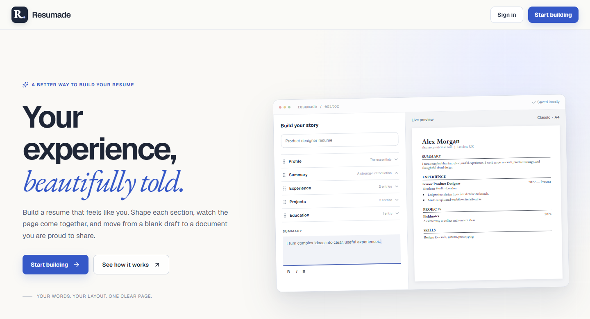
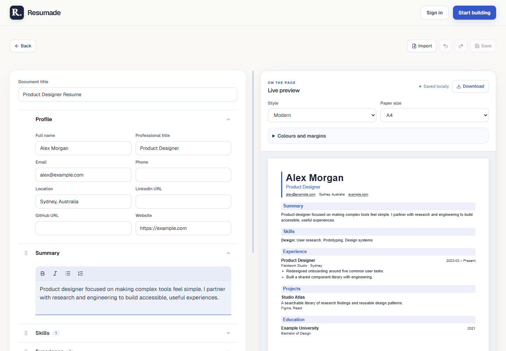

# Resumade

Resumade is a web app for building and revising resumes. Start from a template or import an existing PDF, edit each section alongside a live preview, and download a PDF with selectable text.

## What you can do

- **Start with a template or an existing PDF.** Choose Classic, Modern, or Custom, or import a PDF with selectable text and review the extracted fields.
- **Edit with a live preview.** Reorder sections and entries by dragging, format descriptions with rich text, and adjust the paper size, colours, and margins.
- **Download your current draft.** Guests and signed-in users can export a PDF using the preview’s layout and styling.
- **Save resumes to an account.** Sign in to open and manage saved resumes from the dashboard.

[See the page gallery](docs/screenshots.md) for the start flow, templates, account pages, and dashboard. Screenshots use fictional resume data.

## For developers

| Part | Stack |
| --- | --- |
| [Web app](web/) | Next.js, React, TypeScript, Tailwind CSS, and Auth.js |
| [API](api/) | ASP.NET Core 10, EF Core, PostgreSQL, and JWT bearer authentication |
| PDF workflow | PDF.js extracts text in the browser. The API parses it and uses PuppeteerSharp with Chromium to export the styled preview. |
| [API tests](tests/Resumade.Api.Tests/) | xUnit integration tests for health and guest PDF export |

[Run Resumade locally](docs/development.md) · [Read the API reference](docs/api.md)
