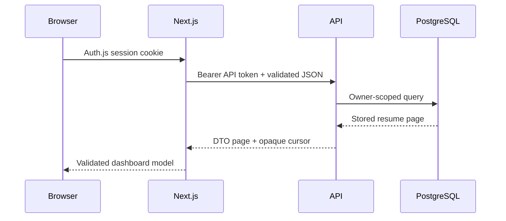
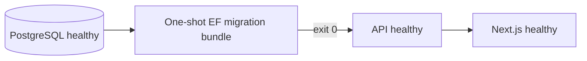

# Architecture

## System context

Resumade is a three-tier application. A Next.js web app presents the editor and owns the browser session, an ASP.NET Core API owns business rules and persistence, and PostgreSQL stores accounts and saved resumes.

```mermaid
flowchart TB
    User[User browser]
    subgraph Edge[Public edge]
        Web[Next.js / Auth.js]
        Api[ASP.NET Core API]
    end
    subgraph Private[Private data network]
        Database[(PostgreSQL)]
    end
    Providers[AI providers]
    Resend[Resend email]

    User -->|HTTPS pages and route handlers| Web
    User -->|HTTPS API where required| Api
    Web -->|JWT-authenticated JSON| Api
    Api -->|EF Core / Npgsql| Database
    Api -->|user-supplied provider key| Providers
    Api -->|server credential| Resend
    User -. PDF.js import and React PDF export .-> User
```

## Responsibilities

### Web app (`web/`)

- Renders the landing, account, dashboard, and editor experiences.
- Uses Auth.js for credential and Google sign-in sessions.
- Validates external API responses again with Zod before using them.
- Extracts source PDF text and generates downloadable PDFs in the browser.
- Forwards authenticated resume operations to the API without exposing the API JWT to browser JavaScript.

### API (`api/`)

- Validates registration, authentication, resume, parsing, and AI requests.
- Enforces resume ownership, the 16-resume cap, and per-client rate limits.
- Serialises the structured resume document into PostgreSQL.
- Validates AI provider responses against the application schema.
- Sends account-action email without returning provider details to clients.

Composition is centralised in `Infrastructure/Configuration/ApiServiceCollectionExtensions.cs`; `Program.cs` is intentionally limited to host creation and pipeline startup. Feature services remain grouped under `Services/Auth`, `Services/Resume`, `Services/Parsing`, and `Services/AI`.

### Database (`api/Data`, `api/Migrations`)

PostgreSQL is authoritative for users, verification/reset tokens, and saved resumes. EF Core migrations are explicit deployment artefacts. The application does not mutate schema during ordinary API startup.

## Trust boundaries



- Browser input is untrusted at both the web and API boundaries.
- The web server holds Auth.js secrets and API tokens; client components must not receive them.
- A forwarded IP is trusted only from an explicitly configured proxy or from the authenticated Vercel assertion flow. Missing trust configuration falls back to the connection address.
- User-provided AI keys exist only for the upstream request. They must not be logged or persisted.
- PostgreSQL is private in Compose. Production ingress should expose only the web app and the API endpoints deliberately required by the deployment.

## Saved-resume pagination

Resume lists use keyset pagination ordered by `(UpdatedAt, Id)` descending. The cursor contains the final item’s UTC ticks and GUID. Using both values makes the order deterministic when several resumes share a timestamp. The next query asks for rows strictly after that tuple, avoiding the growing scan and unstable duplicates common with offset pagination. The cursor is an opaque navigation token, not an authorisation control; every query is still scoped to the authenticated owner.

Pages contain at most eight summaries. Full document content is fetched only when a resume is opened. An account can store at most 16 resumes.

## Container lifecycle



Both application images use separate build and runtime stages and run as non-root users. Compose supplies read-only root filesystems, temporary writable space, health checks, restart policies, resource limits, a private backend network, and a named PostgreSQL volume. A failed migration prevents the API and web app from starting against a partially upgraded schema.

## Failure handling

- Request cancellation propagates through database and provider calls where supported.
- AI calls impose both header and body-read deadlines; receiving headers does not disable the request deadline.
- Malformed saved documents are isolated to the affected card rather than failing an entire dashboard page.
- Oversized parsing requests and whitespace-only payloads are rejected before expensive processing.
- Health checks indicate process reachability. They are not a substitute for provider monitoring or database backups.
