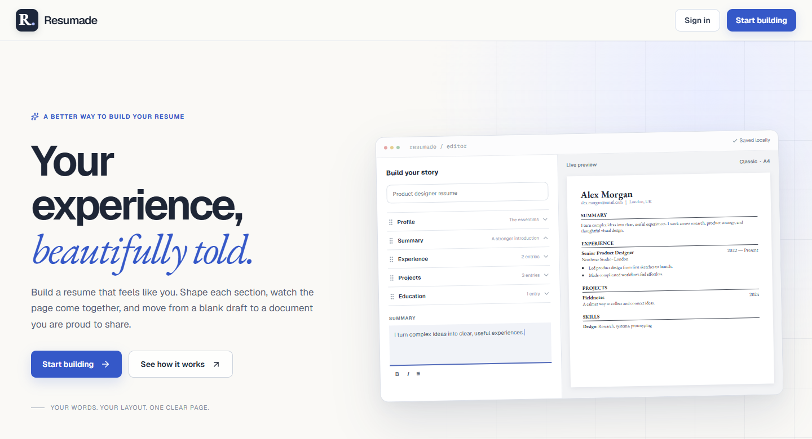
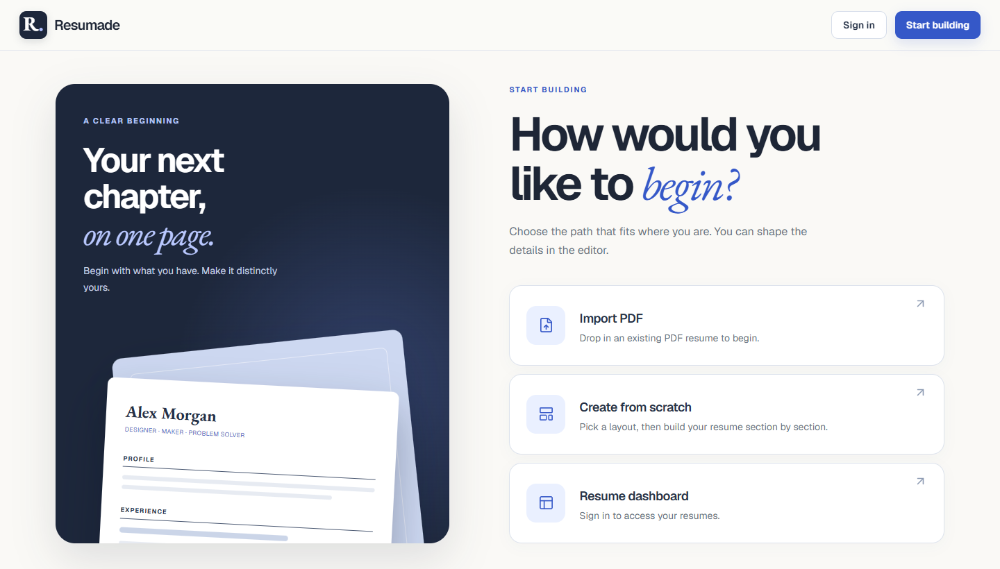
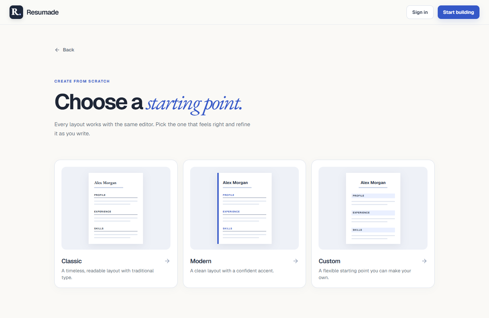
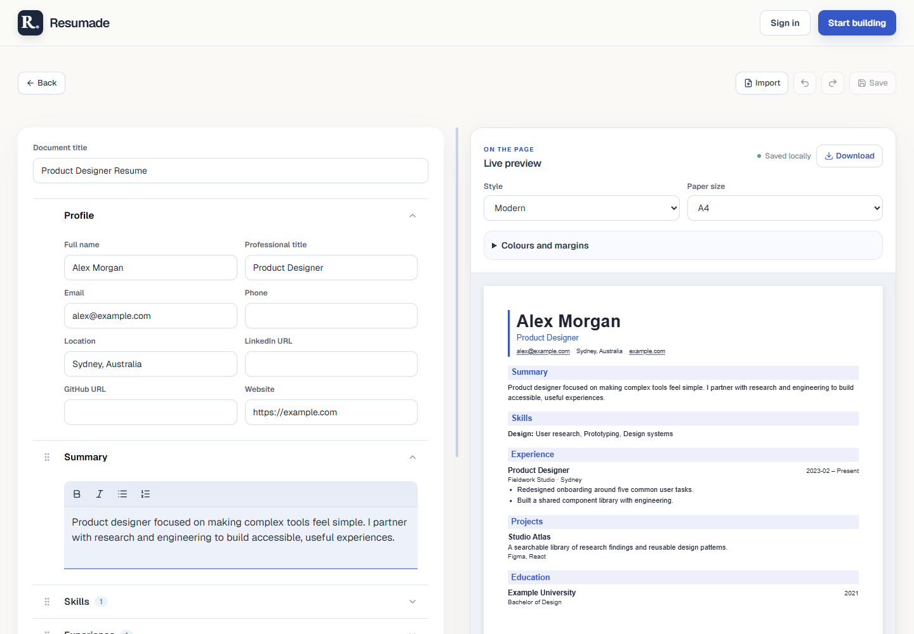
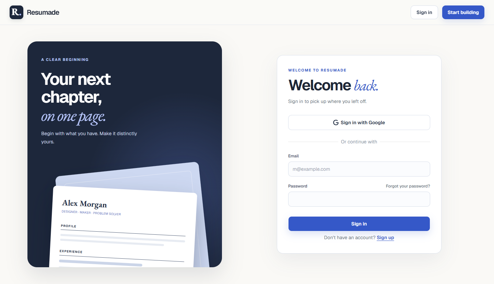
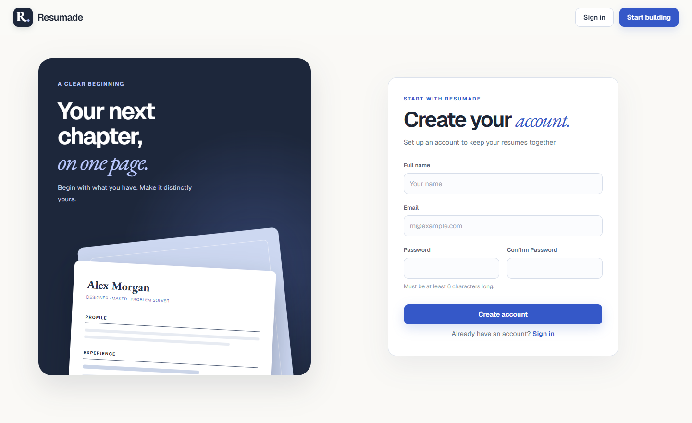
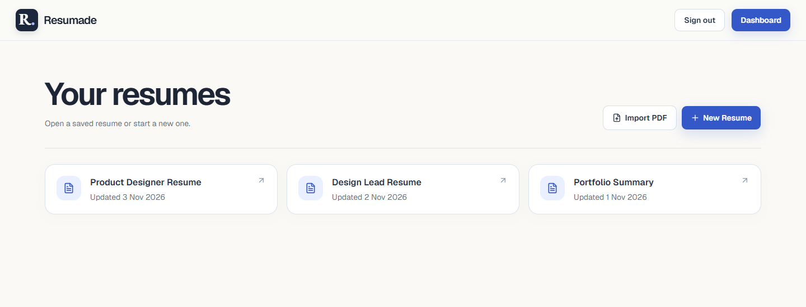

# Resumade page gallery

These desktop screenshots show the current app with fictional resume data.

## Landing page

The landing page introduces the editor and offers a starting point for guests.

## Start building

Guests can import a PDF, build from scratch, or sign in to access their saved resumes.

## Choose a template

The template picker shows Classic, Modern, and Custom layouts before opening the editor.

## Edit and preview

The editor pairs resume fields and rich-text controls with a live preview. The **Download** button exports the current preview as a text-based PDF.

## Account access

<table>
  <tr>
    <th scope="col">Sign in</th>
    <th scope="col">Create an account</th>
  </tr>
  <tr>
    <td></td>
    <td></td>
  </tr>
</table>

## Saved resumes

The dashboard lists account resumes and offers shortcuts to import a PDF or start a new draft.

[Back to the project README](../README.md)
